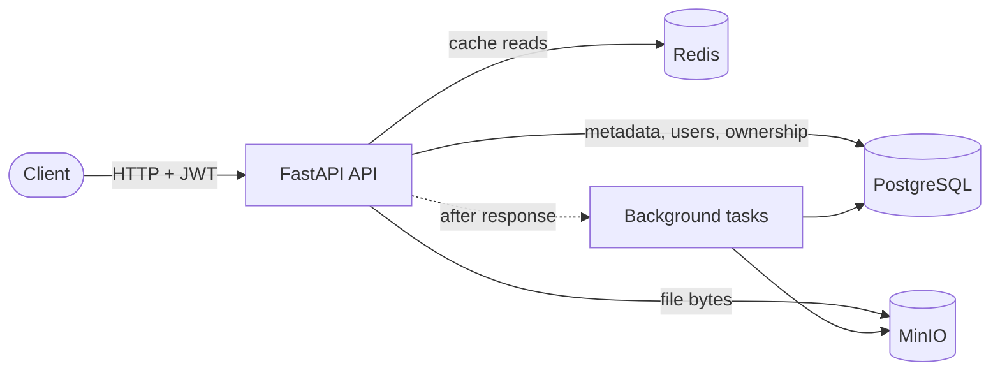
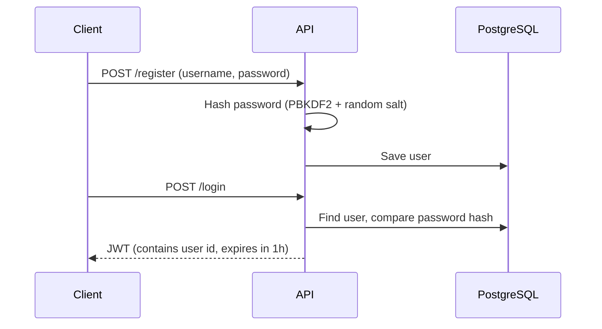
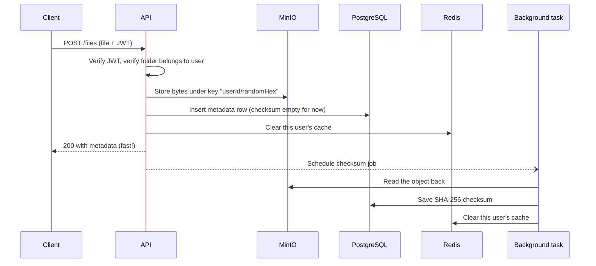
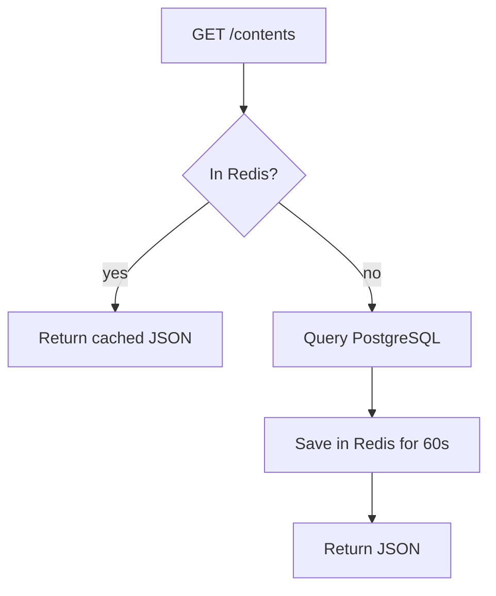
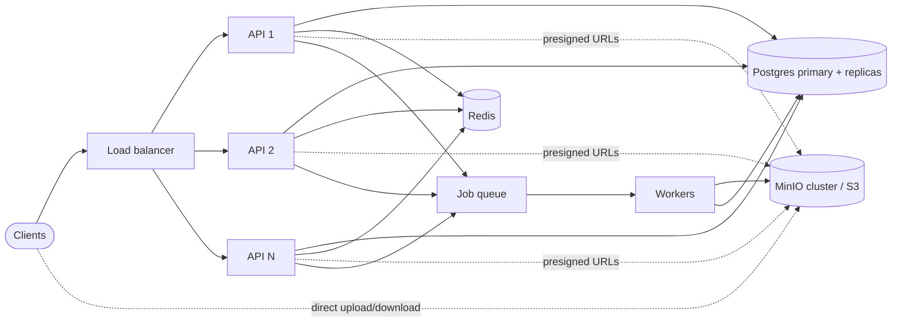

# File Storage Backend

A small, easy-to-read file storage service (think "mini Google Drive API").
Users register, log in, create folders, upload files, and download them. Every user can only see their own data.

**Stack:** Python · FastAPI · PostgreSQL · Redis · MinIO · Docker Compose

The whole app is **one Python file (`main.py`)** so you can read it top to bottom in about 30 minutes.

---

## Table of Contents

1. [Features](#features)
2. [Quick Start](#quick-start)
3. [Project Structure](#project-structure)
4. [Architecture](#architecture)
5. [API Endpoints](#api-endpoints)
6. [Data Flow](#data-flow)
7. [Data Model](#data-model)
8. [Design Decisions and Alternatives](#design-decisions-and-alternatives)
9. [Security Notes](#security-notes)
10. [Known Limitations](#known-limitations)
11. [Future Scope: Scaling](#future-scope-scaling)

---

## Features

- REST APIs to **upload, download, delete and move files**, and **create / delete / list folders**
- **Metadata tracking** for every file (name, size, type, checksum, folder, created time)
- File bytes stored in **MinIO** (S3-compatible object storage)
- Metadata and access control stored in **PostgreSQL**
- **JWT authentication**: every file and folder operation is checked, and users can only touch their own data
- **Redis caching** for frequently requested reads
- **Background tasks** so slow work (checksums, cleanup) never blocks a response
- **One command** starts everything with Docker Compose

---

## Quick Start

You only need Docker installed.

```bash
docker compose up --build
```

Then open:

| URL | What it is |
|---|---|
| http://localhost:8000/docs | Interactive API docs (try every endpoint here) |
| http://localhost:9001 | MinIO web console (login: `minioadmin` / `minioadmin`) |

**Try it in 4 steps (in `/docs`):**

1. `POST /register` with a username and password
2. Click **Authorize** (top right) and log in with the same credentials
3. `POST /files` and upload any file
4. `GET /files/{id}/download` to get it back

To stop everything: `docker compose down` (add `-v` to also delete stored data).

---

## Project Structure

```
.
├── main.py              # the entire application (config, models, auth, endpoints)
├── Dockerfile           # builds the API image
├── docker-compose.yml   # starts API + PostgreSQL + Redis + MinIO
└── README.md
```

`main.py` is split into numbered sections:

| Section | Content |
|---|---|
| 1-2 | Config and connections (Postgres, Redis, MinIO) |
| 3 | Database tables |
| 4 | Startup (wait for services, create tables and bucket) |
| 5 | Authentication (password hashing, JWT, ownership check) |
| 6 | Redis cache helpers |
| 7 | Background tasks |
| 8 | Folder endpoints |
| 9 | File endpoints |

---

## Architecture



**Who stores what:**

| Component | Stores | Why this one |
|---|---|---|
| **PostgreSQL** | Users, folders, file metadata, who owns what | Relational data with links between tables; strong consistency |
| **MinIO** | The actual file bytes | Object storage is built for large files; Postgres is not |
| **Redis** | Temporary copies of frequent reads (60 s) | In-memory, very fast |
| **FastAPI** | Nothing (it is stateless) | Coordinates everything above |

The key idea: **bytes go to MinIO, facts about the bytes go to Postgres**. The two are linked by `object_key` in the `files` table.

---

## API Endpoints

| Method | Path | Auth | Description |
|---|---|---|---|
| POST | `/register` | no | Create an account |
| POST | `/login` | no | Get a JWT (valid 1 hour) |
| POST | `/folders` | yes | Create a folder (optional `parent_id` for nesting) |
| DELETE | `/folders/{id}` | yes | Delete a folder (must be empty) |
| GET | `/contents?folder_id=` | yes | List folders and files inside a folder (omit for root). **Cached** |
| POST | `/files` | yes | Upload a file (form: `file`, optional `folder_id`) |
| GET | `/files/{id}` | yes | Get file metadata. **Cached** |
| GET | `/files/{id}/download` | yes | Stream the file back |
| PUT | `/files/{id}/move?folder_id=` | yes | Move a file to another folder (omit for root) |
| DELETE | `/files/{id}` | yes | Delete a file |

---

## Data Flow

### 1. Register and login



The password is never stored in plain text. The JWT is signed with `JWT_SECRET`, so the server can verify it later **without any database lookup for the token itself**.

### 2. Every protected request (the security gate)

```
Request with header "Authorization: Bearer <JWT>"
   → oauth2 helper pulls the token out of the header
   → current_user() verifies signature + expiry, loads the user
   → endpoint runs with a trusted `user`
   → get_owned() checks the row's owner_id == user.id (otherwise 404)
```

Two checks happen on every call: **who are you?** (JWT) and **is this yours?** (`owner_id`).

### 3. Upload



The client gets a response **before** the checksum is computed. The checksum field is `null` for a moment and then fills in.

### 4. Download

```
Client → API: verify JWT → find file row → check owner_id
API → MinIO: open object by object_key
API → Client: stream it in 64 KB chunks
```

The file is **streamed**, never fully loaded into memory, so large files are fine.

### 5. Listing and metadata (cached reads)



Cache keys look like `user:{id}:contents:{folder_id}` and `user:{id}:file:{file_id}`.

### 6. Any write (upload, delete, move, create folder)

After changing data, the API deletes **all cache keys for that user** (`user:{id}:*`). The next read rebuilds the cache from Postgres, so users never see stale data after their own changes.

### 7. Delete

```
API: verify JWT + ownership
API → PostgreSQL: delete the metadata row
API → Redis: clear user's cache
API → Client: "deleted" (fast)
Background → MinIO: remove the bytes
```

---

## Data Model

```
users                 folders                    files
-----                 -------                    -----
id (PK)               id (PK)                    id (PK)
username (unique)     name                       name
password_hash         parent_id → folders.id     size
                      owner_id  → users.id       content_type
                                                 checksum
                                                 object_key   (path inside MinIO)
                                                 folder_id → folders.id
                                                 owner_id  → users.id
                                                 created_at
```

- `parent_id = NULL` or `folder_id = NULL` means "root".
- Folders can nest because a folder points to its parent folder.
- `object_key` is what ties a database row to the bytes in MinIO.

---

## Design Decisions and Alternatives

### Where do file bytes live? → MinIO

| Option | Why not |
|---|---|
| **Store files in PostgreSQL** (BLOB/`bytea`) | Bloats the database, slows backups, wastes expensive DB I/O on large files |
| **Local disk of the API container** | Lost when the container is replaced; cannot run multiple API copies since each would have different files |
| **AWS S3 directly** | Needs a cloud account and costs money for local development. MinIO speaks the **same S3 API**, so moving to S3 later is a small config change |

### Where does metadata live? → PostgreSQL

| Option | Why not |
|---|---|
| **MongoDB** | The data is naturally relational (users → folders → files). Postgres gives foreign keys and transactions for free |
| **Store metadata in MinIO object tags** | Cannot query ("all files in folder 5") efficiently |
| **SQLite** | Single-writer and not suited to multiple API instances |

### Caching → Redis

| Option | Why not |
|---|---|
| **Python dict in memory** | Each API instance would have its own copy, so caches would disagree and cannot be cleared across instances |
| **Memcached** | Works, but Redis does the same plus TTLs, pattern scans and later queues, so one tool covers more needs |
| **No cache** | Fine for small scale, but the task asked for fast repeated reads |

**Cache invalidation: clear everything for the user on any write.** This is the simplest approach that is always correct. The alternative (updating only the affected keys) is faster but easy to get wrong, because one change can affect a file's own key, its folder's listing and its old folder's listing.

### Authentication → JWT

| Option | Why not |
|---|---|
| **Server-side sessions** (session id in Redis/DB) | Needs a lookup on every request and shared session storage. JWT is verified with just a secret |
| **API keys** | No expiry by default, awkward for end users |
| **Third-party auth** (Auth0, Keycloak) | Great for production, but too heavy for a learning project |

Trade-off: a JWT **cannot be revoked** before it expires. That is why the lifetime is short (1 hour). See [Future Scope](#future-scope-scaling).

### Access control → `owner_id` on every row

Every query goes through `get_owned()`, which only returns a row if `owner_id == user.id`. It returns **404, not 403**, so attackers cannot discover which IDs exist.

| Option | Why not |
|---|---|
| **Per-file ACL tables / roles** | Needed only for sharing, which is out of scope |
| **Postgres Row-Level Security** | Powerful but harder to read and debug for a small project |

### Background work → FastAPI `BackgroundTasks`

| Option | Why not |
|---|---|
| **Celery / RQ + Redis queue** | More moving parts (worker container, broker config). Overkill for two small jobs |
| **Do it inline** | Hashing a big file would make the upload request slow |

Trade-off: tasks run **inside the API process**. If the container crashes mid-task, the task is lost (the checksum stays `null`). Acceptable here; see scaling for the fix.

### Upload path → file streams *through* the API

| Option | Why not |
|---|---|
| **Presigned URLs** (client uploads straight to MinIO) | Better for scale, but needs extra endpoints plus a "confirm upload" step, so it is harder to understand. Going through the API keeps auth and metadata in one simple step |

### Password hashing → PBKDF2 (standard library)

| Option | Why not |
|---|---|
| **bcrypt / argon2** | Slightly stronger and the usual production choice, but adds a dependency (and `passlib` has had compatibility problems). PBKDF2 with a salt is secure and needs no extra package |

### Code layout → one file

| Option | Why not |
|---|---|
| **Layered structure** (`routers/`, `services/`, `models/`, `schemas/`) | The standard for big projects, but for ~230 lines it just makes the reader jump between files |

### Other small choices

- **SQLAlchemy** instead of raw SQL: less boilerplate, safe from SQL injection.
- **Sync endpoints (`def`, not `async def`)**: the MinIO and SQLAlchemy clients are blocking. FastAPI runs `def` endpoints in a thread pool, so they do not block the server.
- **`create_all()` instead of migrations (Alembic)**: simplest way to get tables. Fine for a demo; see scaling.
- **Random `object_key`** (`userId/randomHex`) instead of the real filename: two files with the same name never collide, and user-supplied names never touch the storage layer.

---

## Security Notes

- Passwords are salted and hashed (PBKDF2-SHA256, 100,000 rounds).
- JWTs expire after 1 hour.
- Every file and folder query is filtered by `owner_id`.
- 404 is returned for "not yours" to avoid leaking which IDs exist.
- **Before any real deployment:** change `JWT_SECRET`, the Postgres password and the MinIO credentials in `docker-compose.yml` (use environment files or secrets, never commit real ones), and put the API behind HTTPS.

---

## Known Limitations

Honest list of what this simple version does not do:

- **No file size limit** or per-user storage quota.
- **Checksum is `null` right after upload** until the background task finishes.
- **Possible orphans after a crash:** upload writes MinIO first and then Postgres, and delete removes the row first and then the object. A crash in between can leave an unused object in MinIO.
- **Background tasks are not durable** (lost if the process dies).
- **A folder can only be deleted when empty**, and there is no endpoint to move or rename folders.
- **No pagination** on `/contents`.
- **No token revocation or refresh tokens.**
- **No file sharing** between users.
- **No automated tests or database migrations.**

---

## Future Scope: Scaling

The API is **stateless** (all state is in Postgres, MinIO and Redis), so most scaling steps are about adding copies and swapping components, not rewriting.

### Step 1: Run more API copies
- Put several API containers behind a load balancer (Nginx, Traefik or a cloud LB).
- This works today because JWT needs no shared session and the cache is in Redis, not in memory.

### Step 2: Take file traffic off the API
- Use **presigned URLs** so clients upload/download directly to MinIO/S3. The API only authorizes and records metadata.
- Add **multipart / resumable uploads** for very large files.
- Put a **CDN** in front of downloads.

### Step 3: Make background work durable
- Move jobs to **Celery or RQ** (Redis as the broker) with separate worker containers, retries and monitoring.
- Add jobs that were too heavy before: virus scanning, thumbnails, text extraction.
- Add a **cleanup job** that finds and removes orphaned MinIO objects.

### Step 4: Scale the database
- Add **indexes** on `files(owner_id, folder_id)` and `folders(owner_id, parent_id)`.
- Add **pagination** to listings.
- Use **read replicas** for read-heavy traffic.
- Use a **connection pooler** (PgBouncer) when many API copies connect.
- Introduce **Alembic migrations** for safe schema changes.

### Step 5: Scale storage
- Run MinIO in **distributed mode** (multiple nodes/disks with erasure coding), or switch to **AWS S3 / GCS** (same S3 API, just config).
- Add **lifecycle rules** (move old files to cheaper storage).
- **Deduplicate** identical files using the checksum.

### Step 6: Improve caching
- Replace `scan_iter` pattern-deletion (it scans keys, which gets slow with millions of keys) with **versioned keys** (`user:{id}:v{n}:...`; bump `n` to invalidate everything instantly) or a Redis set that tracks each user's keys.
- Run Redis with replication or Sentinel/Cluster for availability.

### Step 7: Product and security features
- **Refresh tokens** plus a token deny-list in Redis for logout/revocation.
- **Rate limiting** per user (Redis makes this easy).
- **Sharing and permissions** (a `permissions` table: file, user, read/write).
- **Storage quotas**, **file versioning**, **soft delete / trash**, **search**.
- **Observability:** structured logs, Prometheus metrics, tracing.
- **Deployment:** Kubernetes or ECS, CI/CD, automated tests.

### Scaling picture



---

## License

MIT (or whichever license you choose).
